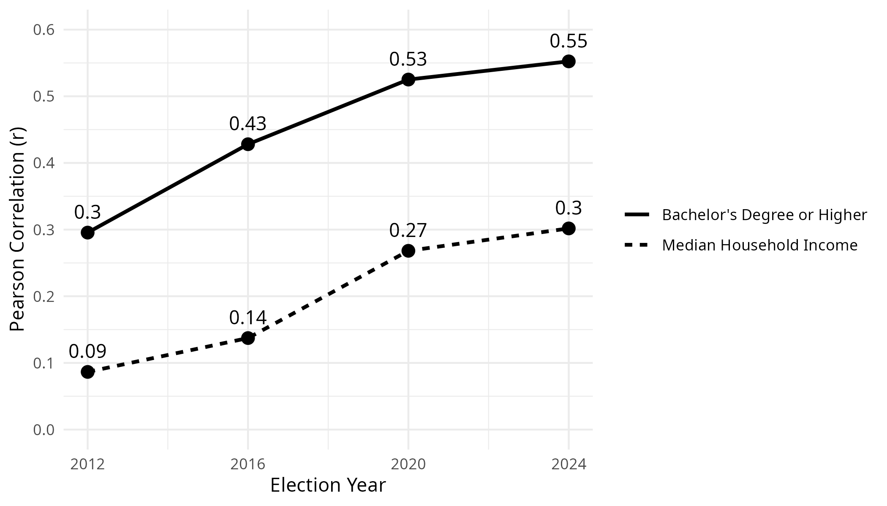
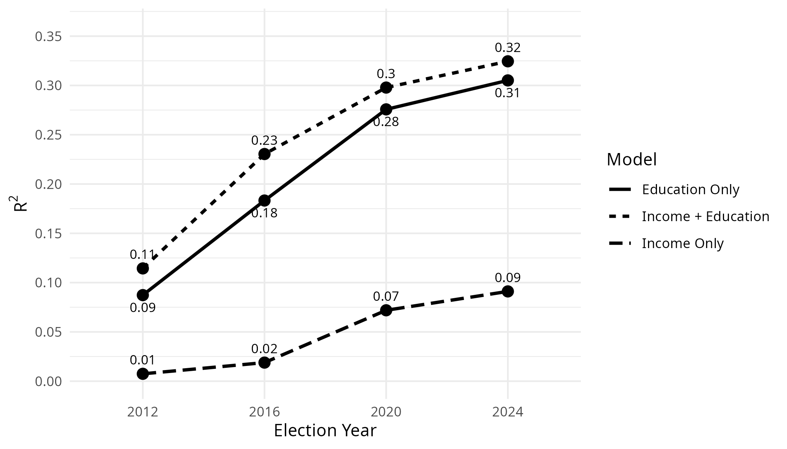
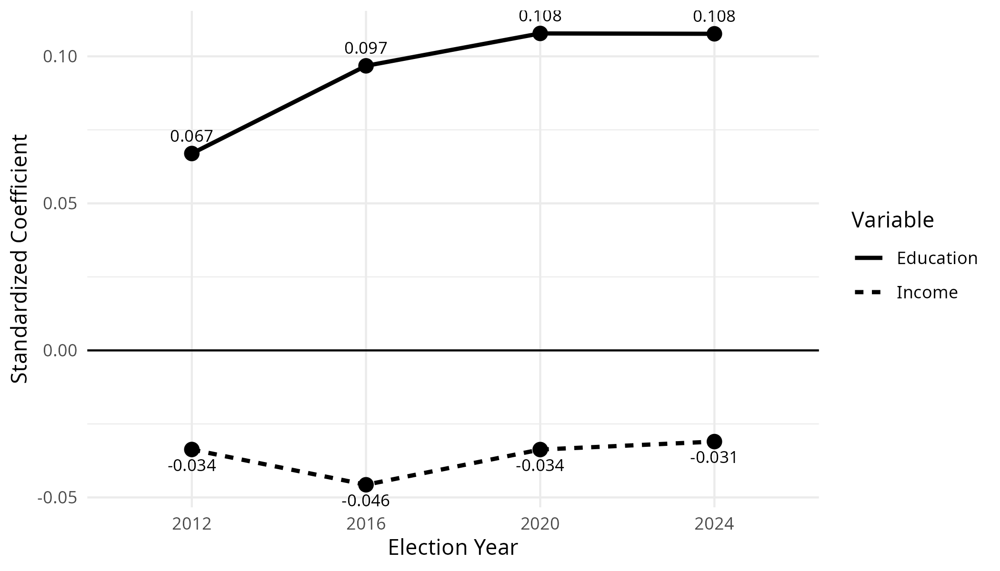

# Income, Education, and Presidential Voting Patterns Across U.S. Counties

**R | Statistical analysis | Linear regression | 10-fold cross-validation | Data visualization**

## Overview

This CU Boulder M.S. Data Science project examines how county-level median household income and educational attainment relate to Democratic presidential vote share across the **2012, 2016, 2020, and 2024** U.S. elections. Election returns from the MIT Election Data and Science Lab were merged with U.S. Census American Community Survey (ACS) five-year estimates. The final analysis reported **12,450 county-election observations**.

## Key findings

- The Pearson correlation between the county share of adults with a bachelor's degree or higher and Democratic vote share increased from **0.295 (2012)** to **0.552 (2024)**.
- The corresponding correlation for median household income increased from **0.087** to **0.302**.
- Models using both income and education achieved the lowest cross-validated prediction error in each election, although the improvement over education alone was modest.

These are **county-level associations**, not evidence of how individual residents voted or that income or education caused changes in voting.

## Approach

1. Clean county-level election returns, selecting reported total voting-mode rows when available.
2. Retrieve ACS county estimates of median household income and bachelor's degree attainment.
3. Join by five-digit county FIPS and election year; exclude unmatched or incomplete observations.
4. Compare Pearson correlations and visualize the relationships across elections.
5. Fit income-only, education-only, and combined linear regression models by year; compare R² and standardized coefficients.
6. Evaluate predictive RMSE using 10-fold cross-validation within each election year.

## Repository contents

- [`code/analysis.R`](code/analysis.R) — complete R analysis and figure-generation code
- [`report/final-report.pdf`](report/final-report.pdf) — final academic report with methodology, figures, results, and references
- [`data/README.md`](data/README.md) — instructions for obtaining the election dataset
- `figures/` — output folder for plots created by the script

## Reproduce the analysis

1. Install R and the `tidyverse` and `jsonlite` packages. In R, run:

   ```r
   install.packages(c("tidyverse", "jsonlite"))
   ```

2. Download the MIT Election Data and Science Lab **County Presidential Election Returns 2000–2024** CSV from https://electionlab.mit.edu/data. Save it as `data/countypres_2000-2024.csv`. The script expects columns including `year`, `state`, `state_po`, `county_name`, `county_fips`, `party`, `mode`, `candidatevotes`, and `totalvotes`.
3. Optionally set a personal Census API key as the environment variable `CENSUS_API_KEY`. Do **not** paste an API key into the script or commit it to GitHub. Census API calls may also work without a key, subject to rate limits.
4. Open R from the **repository root directory**, then run:

   ```r
   source("code/analysis.R")
   ```

The script downloads ACS data for each election year, prints analysis results, and saves three figures under `figures/`. The exploratory scatterplots and cross-validation comparison chart are displayed in an interactive R session but are not automatically saved.

**Reproducibility note:** The script has been adapted for public release, but it has not been rerun against the source datasets in this environment. Confirm the upstream CSV format and API availability before relying on exact reproduced outputs.

## Data sources

- [MIT Election Data and Science Lab — County Presidential Election Returns 2000–2024](https://electionlab.mit.edu/data)
- [U.S. Census Bureau — American Community Survey](https://www.census.gov/programs-surveys/acs)

## Limitations

The analysis is observational and unweighted by county population. It uses only income and education as predictors, so other county characteristics (such as urbanization, region, and age structure) may explain additional variation. The geographic units in some election records could not be matched directly to ACS counties and were excluded. See the [full report](report/final-report.pdf) for details.

## Author

Ben Coleman — M.S. Data Science candidate, University of Colorado Boulder.


## Visualizations

The following figures illustrate the relationships examined in this analysis.

### Figure 1


### Figure 2


### Figure 3

